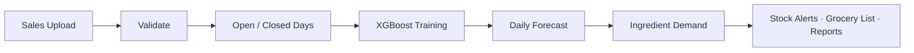
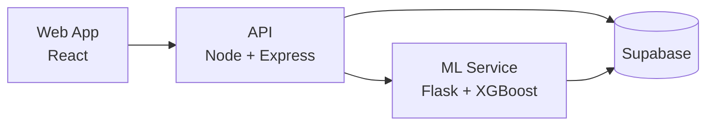

# Demand Forecasting System

**Know what to cook and what to buy before the day starts.**

A web-based demand forecasting and supply chain decision support system for a Filipino micro food service business. It forecasts how many of each menu item will sell, turns that into the ingredients needed, and helps the owner plan restocking.

[The Problem](#the-problem) •
[The Solution](#the-solution) •
[Features](#features) •
[How the Forecast Works](#how-the-forecast-works) •
[Tech Stack](#tech-stack)

> [!IMPORTANT]
> **The system recommends. The owner decides.** Forecasts and grocery lists support decisions; they don't replace the owner's judgment.

---

##  The Problem

Micro food service businesses plan their daily prep and market runs from memory and gut feel. Sales change by weekday and around paydays, and most dishes are made to order from perishable ingredients.

The result: best-sellers run out mid-day, slow items are overstocked, and the owner has no clear view of which products carry the business. Commercial forecasting tools are built for larger companies with years of clean data, not a small store with a daily POS export.

##  The Solution

The system turns the store's daily sales records into a forecast, an ingredient need, and a restocking plan.

| # | Step | What happens |
| :--: | :-- | :-- |
| **1** | **Upload** | The owner uploads daily sales (CSV or Excel). The file is checked and previewed before import. |
| **2** | **Account for every day** | Each date is marked as an open day or a closed day, so gaps don't mislead the model. |
| **3** | **Train** | Once there is enough history, an XGBoost model learns the store's sales patterns. |
| **4** | **Forecast** | Each morning, the system forecasts the quantity of each menu item to be sold. |
| **5** | **Plan ingredients** | Forecast × recipe × safety buffer = ingredients needed, compared against current stock. |
| **6** | **Act** | Stock alerts, a grocery list with estimated costs, and downloadable reports. |

---

##  Features

| Module | What it does |
| :-- | :-- |
|  **Dashboard** | Today's forecast, recent sales, forecast accuracy, and stock alerts at a glance. Guides the owner through setup until forecasts are ready. |
|  **Data Management** | Upload sales files, view historical data, and mark closed days. |
|  **Inventory Management** | Ingredients, recipes, stock levels, restocking, and market price reference. |
|  **Analytics** | Demand forecasting, forecast accuracy, product performance, and demand classification (high, medium, low). |
|  **Ingredient Demand** | Ingredients needed for the forecast and a grocery list of what to buy. |
|  **Notifications** | Upload reminders, low-stock alerts, and new or discontinued product detection. |
|  **Settings** | Business profile, forecast settings (safety buffer), stock thresholds, data management, and audit trail. |
|  **Reports** | PDF and Excel exports for forecasts, performance, and purchasing. |

---

##  How the Forecast Works

 <b>One model for the whole menu</b>

 

A single **XGBoost** model is trained on the sales history of every active product at once, with the product as one of its inputs. Products with few sales can still learn weekday and payday patterns from the rest of the menu.

The model predicts **quantity sold**, not revenue.

 <b>What the model looks at</b>

 

| Group | Inputs |
| :-- | :-- |
| Product | Which menu item |
| Calendar | Day of week, month, day of month, weekend, payday |
| Recent sales | Yesterday's sales, same weekday last open day, days since last open day, 7-day and 14-day averages |

 <b>How it is evaluated</b>

 

- Data is split **by date, never at random**, so the model is always tested on days it has never seen.
- Accuracy is measured with **WMAPE** (weighted mean absolute percentage error), alongside MAE and RMSE.
- The model is always compared against simple baselines, such as the 7-day average, to check that it adds real value.

---

##  Tech Stack

| Layer | Technology |
| :-- | :-- |
| Frontend | React, Vite, Recharts |
| Backend API | Node.js, Express |
| Machine Learning | Python, Flask, XGBoost, pandas, scikit-learn |
| Database & Auth | Supabase (PostgreSQL) |

---

##  Data Privacy

This system was built for a real client. Client sales records, business details, and credentials are kept private and are not shared in this README. Access to the system requires an owner account.

---

##  About This Project

Capstone project for the **BS Information Technology** program at **Pamantasan ng Lungsod ng Pasig**:

**Demand Forecasting System for Supply Chain Decision Support in Micro Enterprise Food Service Using eXtreme Gradient Boost (XGBoost)**

Intended for academic and research purposes.

<!-- Team: add each member's name, role, and GitHub link here. -->

---

Made for Filipino micro food businesses — *less guessing, less waste.*

